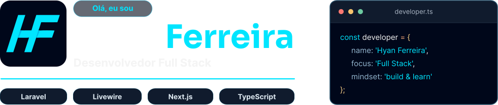
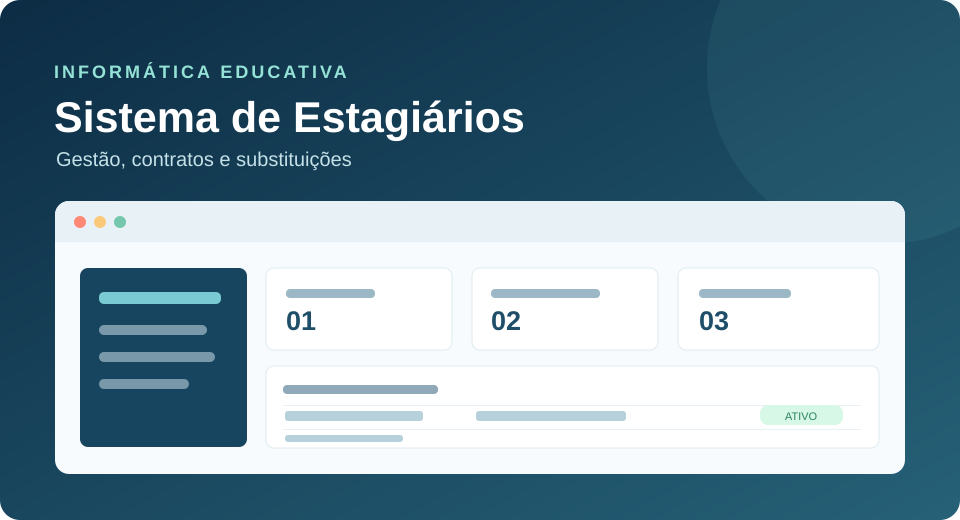
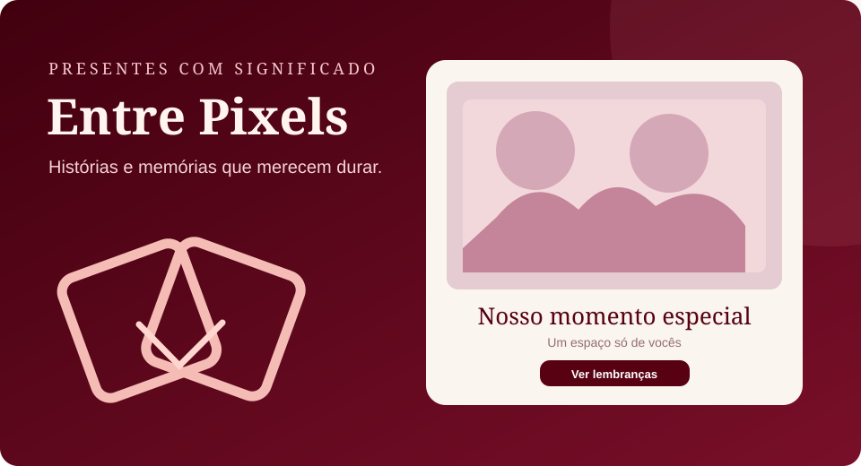

  <picture>
    <source media="(prefers-color-scheme: dark)" srcset="assets/banner.svg">
    
  </picture>

  
  
  

Sou **desenvolvedor Full Stack**, de Caraguatatuba (SP), com foco em **PHP, Laravel, Livewire e Next.js**. Atuo no desenvolvimento de sistemas web, portais institucionais, APIs e interfaces administrativas. Sou estagiário na área de Informática Educativa da Secretaria de Educação de Caraguatatuba e estudante de Análise e Desenvolvimento de Sistemas no IFSP.

- **Sistema de Estagiários:** atuo na manutenção e modernização de um sistema legado, com refatoração de interfaces, gestão de cadastros, substituições, contratos e regras de negócio.
- **Portal da Educação:** contribuo para o desenvolvimento de módulos de conteúdo, gestão e indicadores, com atenção à experiência de usuários e administradores.
- **SIGTU:** participo do desenvolvimento de uma solução de transporte universitário com frontend em Next.js, API Laravel e validação de presença por QR Code.
- **Hackathons e ensino:** conquistei o **3º lugar no Hackathon IFSP 2025**, participei do desenvolvimento do **Paideia** no Hackathon 2026 e ministrei minicursos introdutórios de HTML, Tailwind CSS, PHP e Laravel no IFSP.

 

## Stack

  

Livewire · TallStackUI · Jetstream · Sanctum · APIs REST

## Projetos

<table>
  <tr>
    <td width="50%" valign="top">
      
       <strong><a href="https://hyanferreira.com.br/projetos/portal-educacional-aurora">Portal Educacional Aurora</a></strong>
       Versão demonstrativa de um portal com CMS administrativo, notícias, escolas, eventos, documentos e indicadores. Usa dados fictícios para apresentar o projeto sem expor informações institucionais.
       Laravel · Livewire · Tailwind CSS · MySQL
       <a href="https://instituto-aurora.hyanferreira.com.br/">Abrir demo</a>
    </td>
    <td width="50%" valign="top">
      
       <strong><a href="https://hyanferreira.com.br/projetos/bug-no-anzol-paideia">Bug no Anzol — Paideia</a></strong>
       Plataforma educacional gamificada, desenvolvida em equipe no Hackathon IFSP 2026, com XP, conquistas, desafios, rankings e acompanhamento do aprendizado.
       Next.js · TypeScript · Laravel · Reverb
       <a href="https://bugnoanzol.hyanferreira.com.br/">Abrir demo</a> · <a href="https://github.com/HyanFerreira/hackathon-project-frontend">Código do frontend</a>
    </td>
  </tr>
  <tr>
    <td width="50%" valign="top">
      
       <strong>Sistema de Estagiários</strong>
       Modernização e evolução de um sistema institucional de gestão de estagiários, com dashboards, fluxos de cadastro, acompanhamento de contratos e substituições.
       Laravel · Livewire · TallStackUI · MySQL
       Projeto institucional · código privado
    </td>
    <td width="50%" valign="top">
      
       <strong>SIGTU — Transporte Universitário</strong>
       Projeto colaborativo de gestão do transporte universitário, com linhas, vínculos de estudantes, controle de presença por QR Code e integração entre frontend e API.
       Next.js · TypeScript · Laravel API · MySQL
       Projeto em equipe
    </td>
  </tr>
  <tr>
    <td width="50%" valign="top">
      
       <strong>Entre Pixels</strong>
       Produto pessoal em desenvolvimento para criar presentes digitais e guardar memórias especiais, com experiências personalizadas para casais.
       Laravel · Livewire · Tailwind CSS · MySQL
       Produto próprio · em desenvolvimento
    </td>
    <td width="50%" valign="top">
      
       <strong><a href="https://hyanferreira.com.br/projetos/scrollfolio-template">Scrollfolio Template</a></strong>
       Template de portfólio responsivo, com seções reutilizáveis, navegação fluida e uma apresentação visual voltada a projetos e serviços.
       Next.js · React · TypeScript · Tailwind CSS
       <a href="https://scrollfolio.hyanferreira.com.br/">Abrir demo</a>
    </td>
  </tr>
</table>

Os projetos institucionais podem ter código privado. As imagens desses projetos são capas ilustrativas; as demonstrações do portfólio usam dados fictícios quando necessário.

 

<picture>
  <source media="(prefers-color-scheme: dark)" srcset="https://raw.githubusercontent.com/HyanFerreira/HyanFerreira/output/github-snake-dark.svg">
  
</picture>
